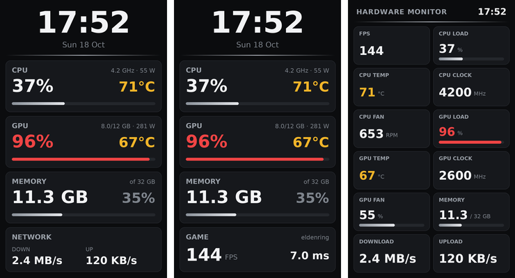
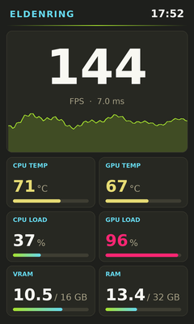
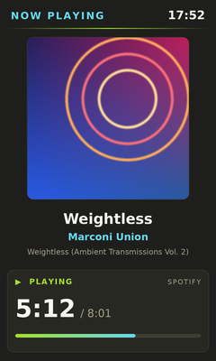
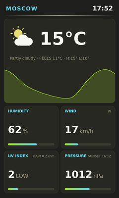
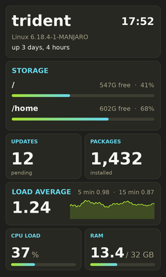

# msi-hmi-linux

Linux support for the **MSI HMI 2.0** touch display on the front of the **MSI MEG Trident X2**
(USB `1462:922c`, "HMI2.0 (MS-B922C)"), and its **Mystic Light** RGB controller (`1462:931b`).

On Windows the panel is driven by MSI Center. Without it the panel just shows a loading
logo and keeps resetting. `hmid` is a small service that takes MSI Center's place on Linux.



> Not affiliated with or endorsed by MSI. "MSI", "MEG", "Trident" and "Mystic Light" are
> trademarks of Micro-Star International. The panel protocol was worked out from USB
> captures of the device's behaviour; this project contains no MSI code or assets.

## Screens

Built-in layouts and examples, in the default Monokai theme (14 more themes are one command away):

| [gaming](src/hmid/data/layouts/gaming.json) | [now-playing](src/hmid/data/layouts/now-playing.json) | [weather](src/hmid/data/layouts/weather.json) | [system](examples/layouts/system.json) |
|:-:|:-:|:-:|:-:|
|  |  |  |  |
| FPS and frame times; can switch on by itself while a game runs (`game_screen`) | album cover and progress from Spotify or any player | MET Norway, no API key | disks, pending updates, load |

`sudo hmictl layout gaming` shows one. More in the [example gallery](examples/layouts/README.md);
your own screens: [docs/LAYOUTS.md](docs/LAYOUTS.md).

## Features

- **Starts with the PC**: the panel is set up at boot and after resume. It shows sleep,
  hibernate, shutdown and restart screens, and the backlight turns off while the PC sleeps.
- **Live stats screen**: clock, CPU, GPU and memory with usage bars, plus network
  traffic, or FPS while a game runs with MangoHud.
- **Hardware monitor in both of MSI's modes**:
  - *list*: the panel draws one sensor per screen and cycles through them
  - *multi*: up to 12 sensor tiles per page
- **The panel's own touch menu works**:
  - volume and microphone presets (PipeWire or PulseAudio)
  - media keys (playerctl)
  - Free Up Memory
  - countdown timer, with a desktop notification and alarm sound
  - Mystic Light effects
  - power menu
  - your own commands for the shortcut buttons
- **Mystic Light** effects are applied directly over HID, including CPU-temperature colours.
- **Board sensors**: CPU, pump and system fans and VRM temperature from MSI's NCT6687
  chip, plus NVIDIA or AMD GPU readings.
- **Custom screens**: design your own page in a JSON file with text, live values,
  sensor tiles, graphs and images, and show your own data from a command, file or web
  API (a creator dashboard, the weather, crypto prices…). See [docs/LAYOUTS.md](docs/LAYOUTS.md)
  and the [example gallery](examples/layouts/README.md).
- **Proxy**: the web requests of layouts can go through a SOCKS5 or HTTP proxy.
- **Pictures**: show your own picture, an animated GIF or a short video clip on the panel
  (`hmictl picture …`), or one of the panel's built-in pictures.
- **15 colour themes** (Monokai by default, Catppuccin, Nord, Dracula, Tokyo Night, Gruvbox…) for
  every screen, switched with one command or from the panel.
- **Clock** with the panel's built-in faces, and adjustable brightness.

## Install

**Arch / Manjaro**: build the package from `packaging/arch`. It downloads the release
tarball named in the PKGBUILD:

```sh
git clone https://github.com/legik/msi-hmi-linux && cd msi-hmi-linux/packaging/arch
makepkg -si
sudo systemctl enable --now hmid
```

**Any distribution**: install into `/opt/hmid` with the dependencies from your package manager:

```sh
git clone https://github.com/legik/msi-hmi-linux && cd msi-hmi-linux
sudo ./install.sh            # sudo ./install.sh --uninstall to remove
```

Requirements: Python ≥ 3.10, pyusb, Pillow and a TTF font (DejaVu). These are optional:
`wpctl`/`pactl`, `playerctl`, `notify-send`, `mangohud` and `dmidecode`.

Upgrading from the old script version in `/opt/hmi`? `install.sh` removes it and keeps `/etc/hmid.json`.

## Use

```sh
sudo hmictl status                 # connection and settings
sudo hmictl stats                  # default screen: stats | hwmon | clock | menu
sudo hmictl layout gaming          # a layout screen: built-in (classic, gaming, weather, ...) or yours
sudo hmictl customize weather      # copy a built-in layout to /etc/hmid/layouts to edit it
sudo hmictl hwmon multi            # hardware monitor as tiles (or: list)
sudo hmictl brightness 60
sudo hmictl set debug_events true  # any setting from /etc/hmid.json (get = list them, unset = default)
sudo hmictl theme nord             # colour theme for every screen (themes = list, next = cycle)
sudo hmictl sensors                # every sensor name with its current reading
sudo hmictl light 82 0ABAB5        # Mystic Light: Steady in Tiffany blue
sudo hmictl picture ~/cat.gif      # picture, animated GIF or video clip; fills the screen (or: picture fit …)
hmictl preview out.png multi       # draw a page with your live readings, no panel needed
```

`hmictl` has tab completion in zsh and bash (commands, layout and theme names, files),
also after `sudo`. Open a new terminal after installing. If zsh doesn't complete yet, run
`rm -f ~/.zcompdump* && exec zsh` once.

Settings live in `/etc/hmid.json` and every key is optional. For example:

```json
{"screen": "hwmon", "hwmon_mode": "multi", "brightness": 50,
 "hwmon_sensors": ["fps", "cpu_load", "cpu_temp", "gpu_load", "gpu_temp", "ram_used"]}
```

See **[docs/CONFIGURATION.md](docs/CONFIGURATION.md)** for every option and the touch-action format.

## Hardware setup

- **Fans and VRM temperature**: load the board's sensor driver with `modprobe nct6683 force=1`.
  See [docs/HARDWARE.md](docs/HARDWARE.md#fans-and-vrm-temperature).
- **FPS**: enable logging in MangoHud with its overlay hidden. See [docs/HARDWARE.md](docs/HARDWARE.md#fps-mangohud).

## Documentation

| | |
|---|---|
| [LAYOUTS](docs/LAYOUTS.md) | designing your own screens |
| [CONFIGURATION](docs/CONFIGURATION.md) | all settings, touch actions, panel item numbers |
| [HARDWARE](docs/HARDWARE.md) | supported devices, sensors, MangoHud, Mystic Light |
| [TROUBLESHOOTING](docs/TROUBLESHOOTING.md) | common problems and how to collect logs |
| [PROTOCOL](docs/PROTOCOL.md) | the panel's USB protocol, as far as it is known |
| [ARCHITECTURE](docs/ARCHITECTURE.md) | how the code is organised, how to add screens and sensors |
| [CONTRIBUTING](CONTRIBUTING.md) | development setup, tests, research rules |

## Safety

The service only sends commands that MSI Center itself sends. Firmware update, rescue and
settings-save commands are deliberately not implemented, and the only files it deletes are
the picture-slot files MSI deletes before an animation. If the panel
firmware hangs, its hardware watchdog restarts it; the service waits for that, and only
then resets the USB connection.

The service runs as its own user with access to only its two USB devices. The few things
that need root (power and shell-command buttons, layout commands, Free Up Memory) are done
by a small helper that looks up what to run in root-owned files itself, so a bug in the
service cannot run commands as root. See [ARCHITECTURE.md](docs/ARCHITECTURE.md#privileges).

## License

GPL-3.0-or-later. See [LICENSE](LICENSE).
