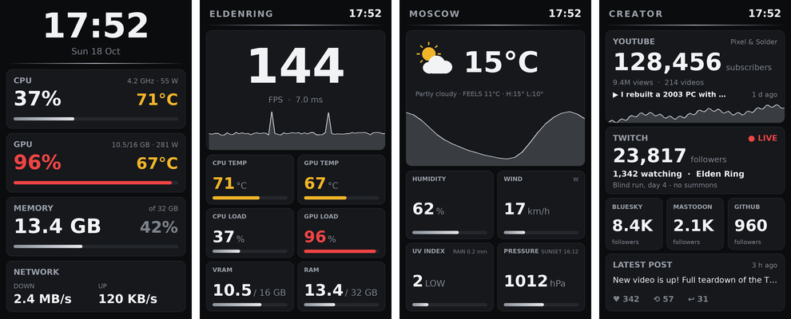

# Custom screens (layouts)

A layout is a JSON file that describes your own screen: text with live values, cards,
bars, sensor tiles, graphs and images on the 480 × 800 panel. It can also show your own
data from a command, a file or a web API.



## Quick start

```sh
sudo hmictl layouts                       # list them: built-in and yours
hmictl preview /tmp/gaming.png gaming     # look at one without the panel
sudo hmictl layout gaming                 # show it on the panel (saved as the default screen)
```

You can also set it in `/etc/hmid.json`: `"screen": "layout:gaming"`.

**Built-in layouts** ship with hmid and update with it, so you never copy them.
**Your layouts** live in `/etc/hmid/layouts/<name>.json`. A file there with the same name
as a built-in layout replaces it. To change a built-in layout, start from a copy:

```sh
sudo hmictl customize gaming              # -> /etc/hmid/layouts/gaming.json, edit it there
```

To go back to the built-in version, which keeps getting updates, delete your copy.

Edit the file and save: the panel picks up the change at the next redraw, with no
restart needed. If the file has a mistake, the panel shows the error message instead.
You can also run `hmictl check file.json`.

The built-in layouts are (source: `src/hmid/data/layouts/`):
- `classic.json`: the built-in stats screen rebuilt as a layout; a good file to start from.
- `gaming.json`: big FPS with an edge-to-edge frame-time graph while a game runs, and a
  2 × 3 grid below: temperatures, loads, VRAM and GPU power.
- `creator.json`: a creator dashboard: YouTube subscribers, views and the latest upload,
  Twitch followers with live status, viewers and the next scheduled stream, Bluesky,
  Mastodon and GitHub followers, and your latest Bluesky post. It needs your ids and
  keys; see [Creator dashboard](#creator-dashboard).
- `weather.json`: weather from MET Norway (`api.met.no`, no API key): icon,
  temperature, condition, feels-like, high/low, a graph of the next 24 hours, humidity,
  wind, UV with rain in the next hour, and pressure with sunset.
  The data updates hourly and the screen once a minute. To change the
  city, edit `lat`/`lon` (at most 4 decimals) in both URLs and the city name in the first
  text widget.
- `now-playing.json`: the track playing in Spotify, a browser or any MPRIS player: album
  cover, title, artist, album and the track's progress. Needs `playerctl`; nothing to set up.
- `weather-openmeteo.json`: the same screen from Open-Meteo, which also has the air
  quality index. Use it if `open-meteo.com` is reachable from your network.

More examples, with pictures, are in [`examples/layouts`](../examples/layouts/README.md):
minimal clock, thermals, history graphs, network, system, markets, a GitHub
project and a world clock.

## File format

```json
{
  "refresh": 3,
  "background": {"color": "#050707"},
  "sources": { ... },
  "widgets": [ ... ]
}
```

| Key | |
|---|---|
| `widgets` | list of widgets, drawn in order; later ones are on top |
| `refresh` | seconds between redraws; default is `stats_interval` (3) |
| `background` | omitted: the theme's dark canvas; `{"color": "#RRGGBB"}`; or `{"image": "/path/picture.png"}`, scaled to 480 × 800 |
| `theme` | pin this layout to a colour theme by name, e.g. `"nord"` (default: the panel's `theme`) |
| `colors` | recolour everything; see [Colours](#colours) |
| `sources` | your own values, described below |
| `comment` | ignored; a note to yourself |

Coordinates are pixels: x 0–480, y 0–800, from the top left.

## Widgets

Every widget has a `type`. It can also have `"when": "<name>"`, which shows the widget
only while that value has a reading, or `"when": "!<name>"`, which shows it only while
the value has none. For example, `"when": "fps"` shows a widget only while a game runs.
A condition can also compare: `"ci.conclusion=success"` (text, any case),
`"change<0"`, `"cpu_temp>=80"` (numbers; `<` `>` `<=` `>=`). `!` in front negates any of
them. A value without a reading never matches.

| type | keys (*required*) | |
|---|---|---|
| `text` | *`x` `y` `text`* `size` `color` `align` `bold` `spacing` `max_width` `value` `rule` `transform` `suffix` `suffix_size` `suffix_color` `suffix_gap` | text with [values](#values) |
| `card` | *`x` `y` `w` `h`* `fill` `border` | rounded panel behind other widgets; `"fill": false` draws only the border |
| `divider` | *`y`* | the thin Tiffany line across the screen |
| `bar` | *`x` `y` `w` `value`* `min` `max` `rule` `warn` `crit` | progress bar for a value between `min` (0) and `max` (100) |
| `sensor` | *`x` `y` `w` `h` `sensor`* `label` `size` `unit_size` `unit_gap` `bar` `bar_min` `bar_max` `bar_rule` `bar_color` | a complete sensor tile; `sensor` is a name from `hmictl sensors` |
| `graph` | *`x` `y` `w` `h`* + `value` or `series`; `seconds` `min` `max` `marker` `color` `fill` `clip` | `value`: history of a value over `seconds` (default 120). `series`: a list value spread across the width, e.g. 24 hourly temperatures |
| `ring` | *`x` `y` `size` `value`* `min` `max` `width` `rule` `warn` `crit` `color` | circular progress centred on `x`, `y`; `size` is the diameter, `width` the ring's thickness (14). Fills clockwise from the top, like a bar |
| `icon` | *`x` `y` `size` `icon`* | weather icon: `clear` `moon` `partly` `partly_night` `cloudy` `fog` `drizzle` `rain` `snow` `storm`, usually from `{weather.current|wmo_icon}` |
| `image` | *`x` `y` `path`* `w` `h` `fit` `radius` | PNG/JPEG, scaled to `w` × `h`. `path` can be a value, e.g. `"{player\|line(9)}"`, and a file path or an `http(s)://` / `file://` link; links load in the background and the last few are kept. `fit`: `stretch` (default), `cover` (fill, cropping the edges) or `contain` (fit inside). `radius` rounds the corners |

Text options:
- `size` is in pixels (default 20) and `bold` defaults to `true`.
- `align` is `left`, `center` or `right`; `x` is where the text starts, its centre or its end.
- `max_width` shortens long text with "…", and `spacing` adds letter spacing in pixels.
- `"value": "cpu_temp", "rule": "temp"` turns the text amber or red when that value
  gets warm or hot. `"rule": "load"` does the same for percentages (amber from 65, red from 85).

More text options:
- `transform` can be `upper`, `lower` or `title`. For example, `{game}` with `"transform": "upper"`
  and `"spacing": 2` gives a spaced game name in capitals. The `.exe` / `.x86_64` suffix is
  already removed.
- `suffix` draws a smaller unit right after the text, on the same baseline:
  `{"text": "{vram_used:.1f}", "size": 40, "suffix": "/ {vram_total:.0f} GB"}`.
  `suffix_size` defaults to 22, `suffix_gap` to 4 px, and `suffix_color` to `secondary`.

For bars, `rule` sets when the bar turns amber or red. It defaults to `load`; use `none`
for a plain fill. `min` and `max` can be numbers or value names, e.g. `"max": "vram_total"`.
Your own thresholds override the rule: `"warn": 3, "crit": 6` makes the bar amber at 3 and
red at 6. Text widgets accept the same `warn`/`crit` together with `"value"`.

Series graphs scale to their data unless you give `min`/`max`. `"marker"` puts a dot on
one point; for example, `"marker": "weather.hourly.time|hour_index"` marks the current hour.

Sensor tiles:
- Units are drawn at 22 px, 4 px after the number, on its baseline. Change this with
  `unit_size` and `unit_gap`.
- A tile shows a bar when its reading is a percentage. To give any tile a bar, set its range:
  - `"bar_min": 30, "bar_max": 95, "bar_rule": "temp"`: a temperature bar from 30 to
    95 °C, amber from 65 °C and red from 80 °C.
  - `"bar_max": "gpu_power_limit", "bar_rule": "none", "bar_color": "accent"`: power
    against the card's power limit.
  - `"bar": false` hides the bar.
- Give every tile in a row a bar, so their numbers line up.

Graphs: with `"clip": true`, a graph placed flush with the bottom of a card is clipped to
the card's rounded corners. Draw the card's border again on top with
`{"type": "card", ..., "fill": false}`, as `gaming.json` does.

Colours can be `#RRGGBB`, `#RRGGBBAA` or a theme name: `text`, `secondary`, `header`,
`value`, `accent`, `accent_dark`, `warn`, `crit`, `track`, `card`.

## Colours

Layouts follow the panel's colour theme (`theme` in `/etc/hmid.json`, or
`sudo hmictl theme <name>`), so every built-in layout changes with it. A layout can pin
its own theme with `"theme": "nord"`, or change single colours on top with `colors`.

`colors` changes the theme for the whole layout: cards, bars, tracks, the divider,
warnings and the background. Every name is optional:

| Name | Used for |
|---|---|
| `canvas` / `glow` | background, and the soft glow at the top (`"glow": null` for a flat background) |
| `card` / `card_border` | card fill and border |
| `header` / `value` / `text` / `secondary` | card titles / big numbers / plain text / units and labels |
| `accent` / `accent_dark` | divider and graphs / second accent |
| `bar_start` / `bar_end` / `track` | bar gradient / empty part of bars |
| `warn` / `crit` | warm and hot values |

For example, Gruvbox's colours as `colors` (the same as `"theme": "gruvbox"`):

```json
"colors": {
  "canvas": "#1d2021", "glow": null, "card": "#282828", "card_border": "#3c3836", "track": "#3c3836",
  "header": "#8ec07c", "value": "#ebdbb2", "text": "#ebdbb2", "secondary": "#a89984",
  "warn": "#fabd2f", "crit": "#fb4934", "accent": "#8ec07c", "accent_dark": "#689d6a",
  "bar_start": "#689d6a", "bar_end": "#8ec07c"
}
```

## Values

Text uses `{name}` or `{name:format}` (Python format syntax). For example,
`"{cpu_load:.0f}%"`, `"{subs:,.0f}"` gives 128,456, and `"{time:%A %d %B}"` gives
Sunday 18 October. A value without a reading shows as `–`.

| Name | |
|---|---|
| `time` | current time; format with `strftime` codes, e.g. `{time:%H:%M}` |
| `cpu_load` `cpu_temp` `cpu_power` `cpu_clock` `cpu_ghz` | % · °C · W · MHz · GHz |
| `gpu_load` `gpu_temp` `gpu_power` `gpu_power_limit` `gpu_clock` `gpu_fan_pct` `vram_used` `vram_total` | % · °C · W · W (TDP) · MHz · % · GB · GB |
| `ram_used` `ram_total` `ram_pct` `ram_clock` | GB · GB · % · MHz |
| `cpu_fan` `cpu_fan_pct` `pump` `sys_fan` `sys_fan_pct` `vrm_temp` | RPM · % · °C (board sensor chip) |
| `download` `upload` | formatted text, e.g. `2.4 MB/s` |
| `net_down` `net_up` | bytes per second, as numbers |
| `fps` `frametime` `game` | while a game runs with MangoHud |
| *your source names* | see below |

## Paths and filters

When a source returns a whole JSON document (no `json` key), use paths into it. Numbers
pick list items:

```
{weather.current.temperature_2m:.0f}°C        {weather.daily.temperature_2m_max.0:.0f}°
```

Filters change a value. Add them with `|`, and you can chain several:

| Filter | |
|---|---|
| `wmo` | WMO weather code → text ("Partly cloudy") |
| `wmo_icon` | weather code → icon name; given `weather.current`, it also uses `is_day` for night icons |
| `compass` | degrees → N, NE, E, SE, S, SW, W, NW |
| `uv_level` | UV index → LOW (< 3), MOD (3–5), HIGH (≥ 6) |
| `time` | ISO date-time → `HH:MM` ("2026-10-18T18:12" → 18:12) |
| `date` | ISO date-time → "Sun 18 Oct" |
| `ago` | ISO date-time → "5 min ago", "3 h ago", "2 d ago", or "in 2 d" for a future time |
| `now` | hourly list → the value for the current hour (in the location's time zone) |
| `hour_index` | position of the current hour in an hourly list |
| `met_text` / `met_icon` | MET Norway symbol (`lightrainshowers_day`) → text ("Light rain showers") / icon name |
| `feels` | feels-like temperature, computed from a dict with `air_temperature`, `relative_humidity`, `wind_speed` (m/s) |
| `today` | list of entries with a `time` → only today's |
| `pluck(path)` | list of entries → the value at `path` in each |
| `first(n)` | first `n` items of a list |
| `max`, `min` | largest / smallest number in a list |
| `mul(x)` | multiply, e.g. m/s → km/h with `mul(3.6)` |
| `upper`, `round` | capital letters, nearest whole number |
| `compact` | 128456 → 128K, 2340000 → 2.3M |
| `line(n)` | line `n` (from 0) of a command's output; lets one command give several values |

```
{weather.hourly.uv_index|now:.0f} {weather.hourly.uv_index|now|uv_level}     → 4 MOD
```

Chained, they turn lists into numbers or series:

```
{met.properties.timeseries|today|pluck(data.instant.details.air_temperature)|max:.0f}°    → today's high
"series": "met.properties.timeseries|first(24)|pluck(data.instant.details.air_temperature)"
```

`time` shows times that carry a zone (`…Z`, `…+02:00`) in this PC's time zone.

Paths and filters work everywhere a value name does: text, `value`, `series`, `when`, `min`/`max`.

## Sources: your own data

```json
"sources": {
  "subs":    {"type": "http", "url": "https://www.googleapis.com/youtube/v3/channels?part=statistics&id=ID&key=KEY",
              "json": "items.0.statistics.subscriberCount", "every": 300},
  "weather": {"type": "http", "url": "https://wttr.in/?format=%t+%C", "every": 900},
  "todo":    {"type": "file", "path": "/home/me/todo.txt"},
  "mail":    {"type": "command", "run": "notmuch count tag:unread", "every": 60}
}
```

| Key | |
|---|---|
| `type` | `http` (web address), `file`, or `command` (shell command) |
| `url` / `path` / `run` | what to read |
| `json` | take one value out of a JSON answer (dotted path, list items by number); leave it out to keep the whole document and use [paths](#paths-and-filters) |
| `every` | seconds between updates (default 60; 5 for files). Weather data barely changes, so 3600 (hourly) is plenty. Free services ask you not to poll more often than needed |
| `timeout` | seconds (default 10) |
| `as` | `command` only: `"user"` runs the command as the logged-in desktop user, inside their session, for programs that need it (`playerctl`, `wpctl`, `notify-send`…). Default `root`. Without a desktop session the value is empty |
| `headers` | `http` only: extra request headers, e.g. `{"Authorization": "Bearer …"}` |
| `proxy` | `http` only: this source's own proxy (`"socks5h://127.0.0.1:1080"`), or `false` to go direct when a `proxy` is set in `/etc/hmid.json` ([Network](CONFIGURATION.md#network)) |

How sources behave:
- Sources update in the background, so drawing never waits for them. Until the first
  result, a source shows as `–`. After an error it is retried within 30 s, and the
  error is logged in `journalctl -u hmid`.
- Results are text, but numeric text works with number formats (`{subs:,.0f}`), bars
  and graphs.
- **Commands run as root** (or as you, with `"as": "user"`), done by hmid-helper, so they
  only run from layout files that only root can change: the built-in layouts and
  `/etc/hmid/layouts`. The file and its folder must be owned by root and not writable by
  group or others. Web and file sources work from any layout.
- Keep API keys out of shared layouts. `/etc/hmid/layouts` is readable by every user on
  the PC; to hide a file from them but not from hmid:
  `sudo chgrp hmid file.json && sudo chmod 640 file.json`.

## Creator dashboard

`creator.json` reads public counters from each platform. Replace every `YOUR_…` in its
sources. A platform you don't use can simply be left as it is: its source fails quietly
(one line in the log) and its widgets show `–`. To remove it, delete its source and widgets.

| Platform | What to fill in | Where to get it |
|---|---|---|
| YouTube | `YOUR_CHANNEL_ID`, `YOUR_UPLOADS_PLAYLIST_ID`, `YOUR_API_KEY` | channel id: YouTube Studio → Settings → Channel → Advanced (starts with `UC`). Uploads playlist: the same id with `UC` replaced by `UU`. Key: Google Cloud console → enable *YouTube Data API v3* → Credentials → API key. Both requests together use about 200 of the free 10,000 daily quota units |
| Twitch | `YOUR_TWITCH_LOGIN`, `YOUR_TWITCH_USER_ID`, `YOUR_CLIENT_ID`, `YOUR_APP_TOKEN` | register an application at dev.twitch.tv/console for the client id and secret, then get an app token: `curl -X POST 'https://id.twitch.tv/oauth2/token' -d client_id=ID -d client_secret=SECRET -d grant_type=client_credentials`. The user id: `curl -H 'Client-Id: ID' -H 'Authorization: Bearer TOKEN' 'https://api.twitch.tv/helix/users?login=LOGIN'`. App tokens expire after about 60 days; the log then shows `401` |
| Bluesky | `YOUR_HANDLE.bsky.social` (twice) | your handle; no key |
| Mastodon | `mastodon.social` and `YOUR_NAME` | your server and user name; no key |
| GitHub | `YOUR_GITHUB_NAME` | your user name; no key (60 requests an hour) |

The layout redraws every 30 s and each source has its own `every`, so the platforms are
asked at most every 1–30 minutes (Twitch live status every minute). Keys are readable by
every user on the PC: `sudo chgrp hmid /etc/hmid/layouts/creator.json && sudo chmod 640
/etc/hmid/layouts/creator.json` after `sudo hmictl customize creator`.

## Tips

- Start from `classic.json`. Each card is a `card` plus `text` and `bar` widgets on top of it.
- A good grid: 16 px margins, cards 448 px wide, or two columns of 219 px with a 10 px gap.
- Graphs keep their history while the service runs, including when you edit the file.
  The history starts empty after a restart.
- The overlay is redrawn and uploaded every `refresh` seconds, and each upload takes
  about 0.1 s of CPU. Values under 2 s aren't useful.
