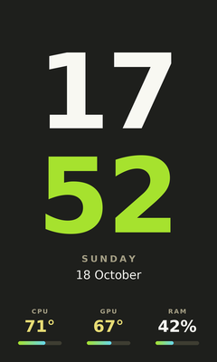
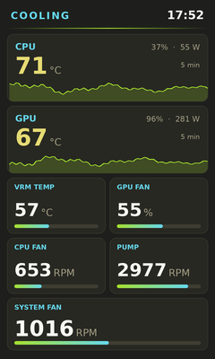
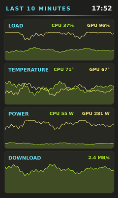
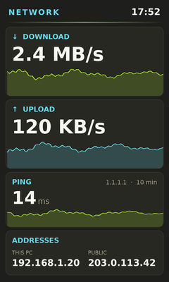
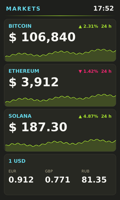
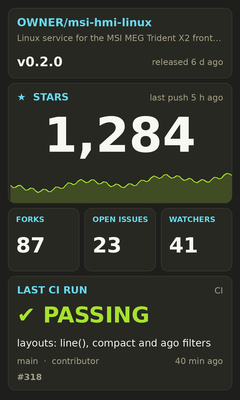
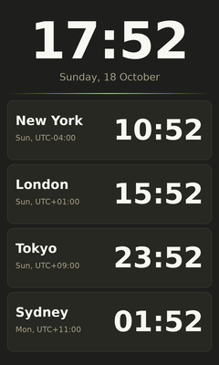

# Example layouts

Ready-made screens to use as they are or to start your own from. The file format is
described in [docs/LAYOUTS.md](../../docs/LAYOUTS.md). The pictures use made-up readings and
the default `monokai` theme; on the panel every example follows your theme.

| | | |
|:-:|:-:|:-:|
| <br>**[minimal](minimal.json)**<br>big clock, three quiet readings | <br>**[thermals](thermals.json)**<br>temperatures, fans, pump | <br>**[graphs](graphs.json)**<br>10 minutes of history |
| <br>**[network](network.json)**<br>traffic, ping, addresses | <br>**[system](system.json)**<br>disks, updates, uptime, load | <br>**[now-playing](../../src/hmid/data/layouts/now-playing.json)** (built-in)<br>album cover and progress, any player |
| <br>**[markets](markets.json)**<br>crypto prices, exchange rates | <br>**[github](github.json)**<br>stars, issues, release, CI | <br>**[world-clock](world-clock.json)**<br>four cities |

`now-playing` is built in: `sudo hmictl layout now-playing` is all it needs (and
`playerctl`). The built-in layouts (`classic`, `gaming`, `weather`, `creator`, `now-playing`) are in
[`src/hmid/data/layouts`](../../src/hmid/data/layouts); `creator` is the dashboard for
YouTube, Twitch, Bluesky, Mastodon and GitHub.

## Using one

```sh
sudo install -m 644 examples/layouts/network.json /etc/hmid/layouts/
sudo hmictl layout network
```

`hmictl preview /tmp/p.png examples/layouts/minimal.json` shows one without the panel.

Copy the file rather than pointing hmid at the repo: examples with `command` sources only
run their commands from root-owned files, which `/etc/hmid/layouts` is.

## What each one needs

| Layout | Sources | Before you use it |
|---|---|---|
| `minimal` | – | nothing |
| `thermals` | – | fans and VRM need the board sensor driver ([HARDWARE.md](../../docs/HARDWARE.md#fans-and-vrm-temperature)); tiles without a reading show `–` |
| `graphs` | – | nothing. History starts when the layout is first shown |
| `network` | commands `ping`, `ip`; web: api.ipify.org | copy to `/etc/hmid/layouts`. Change `1.1.1.1` to ping something else |
| `system` | files in `/proc`; commands `df`, `uptime`, `checkupdates`, `pacman` | copy to `/etc/hmid/layouts`. `checkupdates` is in `pacman-contrib`. On other distributions replace the two pacman commands (e.g. `apt list --upgradable 2>/dev/null \| tail -n +2 \| wc -l` and `dpkg -l \| grep -c ^ii`) |
| `markets` | web: CoinGecko, open.er-api.com | nothing (no key). Coin ids are on coingecko.com; currency codes are ISO (EUR, JPY…) |
| `github` | web: api.github.com | replace `legik/REPO` in the three URLs |
| `world-clock` | command `date` | copy to `/etc/hmid/layouts`. Change the cities in the command (`timedatectl list-timezones`) and the labels |

## Tricks they use

- **Graph with a frame** (`thermals`, `network`, `markets`): a `graph` flush with the card's
  bottom and `"clip": true`, then the card again with `"fill": false` so the border is on top.
- **Two lines in one graph** (`graphs`): two `graph` widgets in the same place, the second
  with `"fill": false` and another `color`.
- **Graph of a slowly growing number** (`github`, `markets`, `creator`): `"min"` relative to
  the value (`"repo.stargazers_count|mul(0.97)"`) so small changes are visible.
- **Commands in your desktop session** (`now-playing`): `"as": "user"` runs a command as
  the logged-in user, so `playerctl` and `wpctl` reach your session. No user name to fill in.
- **Several values from one command** (`now-playing`, `world-clock`): print one value per
  line and pick them with `line(n)`. A command that prints JSON works too (`system`'s `load`).
- **Picture from a value** (`now-playing`): an `image` whose `path` is the player's cover
  link, `"fit": "cover"` and `"radius"`, on top of a card with a ♫ that shows until it loads.
- **Show by state** (`github`, `markets`): `"when": "ci.workflow_runs.0.conclusion=success"`
  for text, `"when": "coins.bitcoin.usd_24h_change<0"` for numbers.
- **Nothing to show** (`now-playing`): `"when": "!player"` for an empty state. Commands end in
  `|| true` so "no player" is an empty value rather than an error, which would keep showing
  the last song.

The pictures are made with `python3 tools/layout_gallery.py docs/images/examples examples/layouts/*.json`.
Add demo values for new sources to `DEMO_SOURCES` in that script; a test checks that
every example draws with them.
